# PixelForge

<p align="center">
  
</p>

<p align="center">
  <strong>Современный, высокопроизводительный аппаратно-ускоренный редактор пиксель-арта для настольных систем</strong>
</p>

<p align="center">
  
  
  
  
  
  
  
  
</p>

---

## 🌟 Ключевые возможности

### 🔄 Полностью автоматическое тихое обновление («Прям само»)
- **Интегрированный In-App загрузчик:** PixelForge самостоятельно опрашивает манифест обновлений в репозитории.
- **Индикатор загрузки:** При выходе новой версии в шапке окна появляется баннер с кнопкой **«Обновить сейчас»** и потоковым прогресс-баром скачивания.
- **Тихая установка:** Загрузка инсталлятора во временную директорию и фоновый запуск Inno Setup (`/SILENT /CLOSEAPPLICATIONS /RESTARTAPPLICATIONS`) без перехода в веб-браузер.
- **Бесшовный перезапуск:** Автоматическое закрытие старого процесса, обновление файлов и мгновенный перезапуск новой версии.

### ✏️ Инструменты с режимом «Pixel-Perfect» (<kbd>Shift+P</kbd>)
- **Удаление L-лесенок в реальном времени:** Алгоритм `PixelPerfectAlgorithm` непрерывно анализирует свободный штрих кисти и ластика.
- **Идеальная чистота линий:** Автоматически устраняет дублирующиеся угловые пиксели (jaggies) на диагоналях, сохраняя непрерывность и кристальную четкость пиксель-арта.
- **Быстрый тумблер:** Включается кнопкой в верхней панели параметров или хоткеем <kbd>Shift+P</kbd>.

### 🎨 Кисти с 8×8 паттернами и текстурным дизерингом (<kbd>P</kbd>)
- **Zero-Allocation битовые маски:** Все паттерны закодированы в 64-битные матрицы `ulong`, полностью исключая аллокации памяти в цикле рисования.
- **11 классических пресетов:**
  - *Checkerboard (50% Dither)*
  - *Dense Dots (25%)* Рё *Sparse Dots (12.5%)*
  - *Кирпичная кладка (Bricks)*
  - *Штриховка крест-накрест (Crosshatch)*
  - *Диагональные полосы (Diagonal Stripes)*
  - *Чешуя (Fish Scales)*
  - *Плетение (Weave)*
  - *Процедурный шум (Noise)*
  - *Горизонтальные и вертикальные линии сканирования (Scanlines)*
- **Полная поддержка инструмента:** Настройка размера кисти, вторичного цвета фона и осевой симметрии X/Y.

### 🎯 Стабилизатор штриха (Stroke Stabilizer 0..10)
- **Сглаживание дрожания:** Экспоненциальное сглаживание траектории курсора мыши и графического планшета.
- **Контроль уверенности:** Настраиваемый ползунок силы сглаживания (от 0 до 10) в верхней панели параметров инструмента.

### 🪄 Волшебная палочка (Magic Wand <kbd>W</kbd>)
- **Выделение по цвету:** Мгновенный выбор пикселей с регулируемым порогом чувствительности (*Tolerance 0..255*) в евклидовом пространстве RGBA.
- **Два режима работы:**
  - **Смежные (Contiguous):** Высокоскоростной BFS-поиск связной области пикселей.
  - **По всему слою (Global):** Выделение всех пикселей холста заданного цветового оттенка.

### 🔒 Блокировка альфа-канала слоя (Alpha Lock)
- **Защита прозрачности:** Переключатель-замочек в каждой строке панели слоев.
- **Удобный шейдинг:** При включенном Alpha Lock любые операции рисования, заливки и стирания воздействуют исключительно на непрозрачные пиксели слоя, гарантируя чистоту контуров спрайта.

### 🪄 Смарт-инструменты (Меню: «Правка» ➔ «Смарт-инструменты»)
- **Автоматическая обводка (Smart Outline):** Генерация контура вокруг видимых пикселей (4-связный или 8-связный) с настройкой толщины и цвета.
- **Автоматическая тень (Smart Shadow):** Быстрое наложение тени с регулируемым смещением по осям X/Y, прозрачностью и цветом.
- **Замена цвета (Color Replace):** Точечная или глобальная замена одного цвета на другой с учетом порога Tolerance.
- Полная интеграция с разреженной историей отмены (Undo/Redo).

### 🧩 Бесшовный режим тайлов (Seamless / Tiled Mode <kbd>F10</kbd>)
- **Предпросмотр сетки 3×3:** Отображение центрального тайла и 8 окружающих копий с разделительной границей в реальном времени.
- **Закольцованные координаты:** Рисование на одном краю холста бесшовно перетекает на противоположный: `x' = (x % w + w) % w`, `y' = (y % h + h) % h`. Незаменимо для создания тайлсетов и текстур уровней.

### 🖼️ Масштабирование и трансформация холста
- **Диалог размера холста (`ResizeCanvasDialog`):** Изменение размеров холста (от 8 до 1024 px) через меню, хоткей <kbd>Ctrl+Alt+C</kbd> / <kbd>Ctrl+R</kbd> или клик по бейджу в строке состояния.
- **Сетка якорей 3×3:** Выбор опорной точки при обрезке или расширении холста.
- **Nearest-Neighbor ресемплинг:** Пропорциональное масштабирование без размытия пикселей.
- **Трансформация холста и слоев:** Отражение по горизонтали/вертикали (Flip H/V), поворот на 90° по и против часовой стрелки, поворот на 180°.

### 🧠 Полная выгрузка в ОЗУ (Zero-Paging RAM Resident)
- **Working Set 256–1024 МБ:** Win32 API `SetProcessWorkingSetSize` удерживает активную память в физической ОЗУ.
- **Pre-faulting страниц:** Модуль `MemoryPreloadService` обходит все страницы библиотек (`libSkiaSharp.dll`, Avalonia, PixelForge), защищая от дискового свопа.
- **Блокировка страниц (`VirtualLock`):** Защита критической памяти от выгрузки в файл подкачки.
- **Опережающая JIT-компиляция (Pre-JIT):** `RuntimeHelpers.PrepareMethod` компилирует методы до первого клика, исключая микрофризы.

### ⚡ Высокопроизводительный конвейер SkiaSharp (60+ FPS)
- **Zero GC-Alloc:** Полное кэширование буферов и объектов отрисовки — ноль аллокаций в обработчиках мыши.
- **Кристальная четкость:** Режим интерполяции строго `SKFilterQuality.None` на любых масштабах (1x..32x).
- **Двухуровневый рендеринг:** Независимый кэш статичного композита слоев + легковесный оверлей инструментов и сетки.
- **Адаптивная пиксельная сетка:** Автоматическое включение сетки при зуме ≥ 4x.
- **Симметрия X / Y в реальном времени:** Зеркальное рисование по обеим осям.

---

## ⌨️ Горячие клавиши

| Действие | Сочетание клавиш | Описание |
| :--- | :---: | :--- |
| **Карандаш (Pencil)** | <kbd>B</kbd> | Рисование с поддержкой Pixel-Perfect |
| **Ластик (Eraser)** | <kbd>E</kbd> | Стирание пикселей в прозрачность |
| **Паттерн-кисть (Pattern Brush)** | <kbd>P</kbd> | Рисование текстурными 8×8 матрицами |
| **Pixel-Perfect режим** | <kbd>Shift</kbd> + <kbd>P</kbd> | Включение/выключение срезания jaggies |
| **Волшебная палочка (Magic Wand)** | <kbd>W</kbd> | Выделение области по цвету |
| **Заливка (Paint Bucket)** | <kbd>G</kbd> | Заливка связной области цвета с порогом |
| **Пипетка (Eyedropper)** | <kbd>I</kbd> | Взятие цвета под курсором |
| **Линия (Line)** | <kbd>L</kbd> | Отрезок по алгоритму Брезенхейма |
| **Прямоугольник (Rectangle)** | <kbd>R</kbd> / <kbd>U</kbd> | Прямоугольник (контур / заливка) |
| **Эллипс (Ellipse)** | <kbd>C</kbd> | Эллипс / круг (контур / заливка) |
| **Выделение (Selection)** | <kbd>S</kbd> / <kbd>M</kbd> | Прямоугольное выделение пикселей |
| **Бесшовный режим (Tiled Mode)** | <kbd>F10</kbd> | Включение/выключение сетки 3×3 тайлов |
| **Поменять цвета местами** | <kbd>X</kbd> | Переключение Primary ↔ Secondary |
| **Размер холста (Resize)** | <kbd>Ctrl</kbd> + <kbd>Alt</kbd> + <kbd>C</kbd> / <kbd>Ctrl</kbd> + <kbd>R</kbd> | Диалог изменения размеров холста |
| **Отмена (Undo)** | <kbd>Ctrl</kbd> + <kbd>Z</kbd> | Отменить последнее действие |
| **Повтор (Redo)** | <kbd>Ctrl</kbd> + <kbd>Y</kbd> / <kbd>Ctrl</kbd>+<kbd>Shift</kbd>+<kbd>Z</kbd> | Повторить отмененное действие |
| **Новый холст** | <kbd>Ctrl</kbd> + <kbd>N</kbd> | Создать новый проект |
| **Открыть проект** | <kbd>Ctrl</kbd> + <kbd>O</kbd> | Открыть файл `.pxproj` |
| **Сохранить проект** | <kbd>Ctrl</kbd> + <kbd>S</kbd> | Сохранить проект |
| **Сохранить как...** | <kbd>Ctrl</kbd> + <kbd>Shift</kbd> + <kbd>S</kbd> | Сохранить с выбором имени |
| **Копировать / Вырезать / Вставить** | <kbd>Ctrl</kbd> + <kbd>C</kbd> / <kbd>X</kbd> / <kbd>V</kbd> | Буфер обмена пикселями |
| **Сетка пикселей** | <kbd>Ctrl</kbd> + <kbd>G</kbd> | Включение / выключение сетки |
| **Масштаб (Zoom)** | <kbd>Ctrl</kbd> + <kbd>+</kbd> / <kbd>-</kbd> или Колесо мыши | Плавный зум с фокусом на курсор |
| **Панорамирование (Pan)** | <kbd>Space</kbd> + Drag или Средняя кнопка мыши | Перемещение холста |

---

## 🏛️ Архитектура системы

```mermaid
graph TD
    subgraph Bootstrap ["Запуск и предзагрузка ОЗУ"]
        SW["SplashWindow (Экран запуска 5с)"]
        AB["AppBootstrapper (Асинхронный оркестратор)"]
        MPS["MemoryPreloadService (Working Set / Pre-JIT / Skia Warm-up)"]
        CRS["CrashReportService (DbgHelp MiniDump & JSON)"]
        LOG["AppLogger (Потоковый debug.log)"]
        SW --> AB
        AB --> MPS
        AB --> CRS
        AB --> LOG
    end

    subgraph UI ["Слой представления (PixelForge.App)"]
        MW["MainWindow (3-колоночный лейаут)"]
        PC["PixelCanvasControl (SkiaSharp 60+ FPS, Tiled View)"]
        LP["LivePreviewControl (1x/2x/4x Preview)"]
        CP["ColorPickerView (Слайдеры, Hex, Палитры)"]
        LM["Менеджер слоев (Layer Manager & Alpha Lock)"]
        RCD["ResizeCanvasDialog (Диалог размера холста)"]
    end

    subgraph MVVM ["Слой ViewModel (CommunityToolkit.Mvvm)"]
        MVM["MainViewModel (In-App Updater, Smart Tools)"]
        TVM["ToolViewModel (Pixel-Perfect, Stabilizer, Patterns)"]
        CVM["CanvasViewModel (Tiled Mode, Dimensions)"]
        LVM["LayerViewModel (Alpha Lock, Blend Modes)"]
        PVM["PaletteViewModel"]
        HVM["HistoryViewModel"]
    end

    subgraph Core ["Ядро приложения (PixelForge.Core)"]
        PCanvas["PixelCanvas (Композит слоев)"]
        Layers["Layer Stack & PixelColor"]
        Tools["ITool: Pencil, Eraser, Fill, Eye, Line, Rect, Ellipse, Select, MagicWand, PatternBrush"]
        Algos["Algorithms: PixelPerfectAlgorithm, StrokeStabilizer"]
        Smart["SmartTools: Outline, Shadow, ColorReplace"]
        Patterns["PatternPresets: 11 8x8 Bitmasks"]
        History["UndoRedoService & PixelDelta"]
        Palettes["PalettePresets: DawnBringer32, Pico8, GameBoy, NES"]
        Export["ExportService (PNG / BMP)"]
        ProjectSvc["ProjectService (.pxproj)"]
        AutoSave["AutosaveService"]
        OTA["UpdateService (In-App Silent Update)"]
    end

    AB --> MW
    MW --> MVM
    MW --> RCD
    PC --> CVM
    LP --> CVM
    CP --> PVM
    LM --> LVM
    MVM --> TVM
    MVM --> CVM
    MVM --> LVM
    MVM --> PVM
    MVM --> HVM
    TVM --> Tools
    TVM --> Algos
    TVM --> Patterns
    CVM --> PCanvas
    LVM --> Layers
    HVM --> History
    MVM --> Smart
    MVM --> Export
    MVM --> ProjectSvc
    MVM --> AutoSave
    MVM --> OTA
```



---

## 📥 Скачать и установить

Готовый компактный установщик доступен на странице **[Релизов GitHub Releases](https://github.com/widlily-corp/PixelForge/releases/latest)**:

1. Перейдите в раздел **[Releases](https://github.com/widlily-corp/PixelForge/releases/latest)**;
2. Скачайте официальный установщик: **`PixelForge_0.1.3_x64-setup.exe`** (~35.18 МБ);
3. Запустите установку — инсталлятор автоматически зарегистрирует ассоциацию файлов `.pxproj`, создаст ярлыки и обеспечит быстрый старт программы;
4. Все последующие обновления будут происходить **автоматически прямо внутри приложения** («Справка» ➔ «Проверить обновления»).

---

## рџ› пёЏ РЎР±РѕСЂРєР° РёР· РёСЃС…РѕРґРЅРѕРіРѕ РєРѕРґР°

### Требования
- [.NET 8.0 SDK](https://dotnet.microsoft.com/download/dotnet/8.0) (или новее)
- [Inno Setup 6](https://jrsoftware.org/isinfo.php) (для сборки установщика: `winget install JRSoftware.InnoSetup`)

### Сборка и тестирование
```powershell
# Сборка Release с проверкой на 0 предупреждений
dotnet build PixelForge.sln -c Release /warnaserror

# Запуск всех 225 тестов (xUnit + FluentAssertions)
dotnet test PixelForge.sln -c Release --no-build
```

### Сборка компактного установщика (Inno Setup LZMA2 Ultra)
```powershell
powershell -ExecutionPolicy Bypass -File .agents/scripts/pack-release.ps1 -Version "0.1.3"
```
Собранный инсталлятор будет расположен в:
`publish/win-x64/PixelForge_0.1.3_x64-setup.exe` (~35.18 РњР‘).

---

## 📄 Лицензия

Проект распространяется под свободной лицензией **Apache-2.0**. Подробности в файле [LICENSE](LICENSE).

Copyright В© 2026 widlily-corp.
