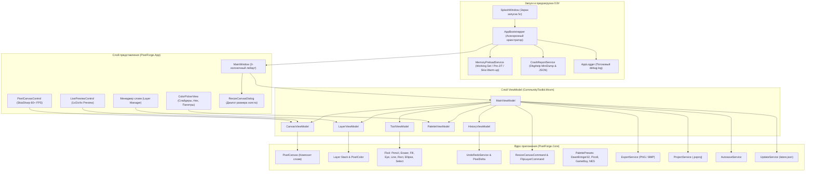

# PixelForge

<p align="center">
  
</p>

<p align="center">
  <strong>Современный, высокопроизводительный аппаратно-ускоренный редактор пиксель-арта для настольных систем</strong>
</p>

<p align="center">
  
  
  
  
  
  
  
  
</p>

---

## 🚀 Ключевые возможности v0.1.0

### 🖼️ Интерактивное масштабирование холста (Canvas Resize & Transform)
- **Диалог размера холста (`ResizeCanvasDialog`):** Полный контроль над размерами холста (от 8 до 1024 px). Доступен через верхнее меню (`Холст -> Размер холста...`), горячие клавиши (<kbd>Ctrl+Alt+C</kbd> / <kbd>Ctrl+R</kbd>) или клик по бейджу размеров в нижней строке состояния.
- **Сетка привязки якоря 3×3:** Выбор точки якоря (Сверху-слева, По центру, Снизу-справа и др.) при расширении или обрезке холста.
- **Режим масштабирования пикселей (Nearest-Neighbor):** Пропорциональное увеличение/уменьшение пикселей без размытия.
- **Быстрые пресеты:** Мгновенный выбор 16×16, 32×32, 48×48, 64×64, 128×128, 256×256, удвоение (2×) и уменьшение вдвое (0.5×).
- **Трансформация слоев:** Зеркальное отражение активного слоя по горизонтали и вертикали (`FlipLayerCommand`), а также полная очистка слоя с обратимостью в истории Undo/Redo.

### 🧠 Полная выгрузка в ОЗУ (Zero-Paging RAM Resident)
- **High-Priority Working Set:** Вызов Win32 `SetProcessWorkingSetSize` выделяет приложению рабочий набор от 256 МБ до 1024 МБ в физической ОЗУ.
- **Предварительный Pre-faulting страниц:** Модуль `MemoryPreloadService` при старте обходит все 4КБ страницы памяти загруженных сборок и нативных библиотек (`libSkiaSharp.dll`, Avalonia, PixelForge), гарантируя 100% резидентность кода в памяти без задержек дискового свопа.
- **Блокировка страниц (`VirtualLock`):** Защита критических страниц памяти процесса от вытеснения в файл подкачки Windows.
- **Опережающая JIT-компиляция (Pre-JIT):** Компиляция всех методов критических типов (`RuntimeHelpers.PrepareMethod`) при старте приложения исключает микрофризы во время рисования.

### 🎨 Экран запуска студии с реальной предзагрузкой (`SplashWindow`)
- **Профессиональный дизайн:** Темная студийная тема (`#12131C`) с неоновыми акцентами (`#00D2FF` / `#818CF8`) и подробной индикацией аппаратного прогресса.
- **Плавная индикация прогресса (~5 секунд):** Оркестратор `AppBootstrapper` проводит пользователя по всем этапам инициализации (выделение ОЗУ, фиксация страниц, Pre-JIT, прогрев SkiaSharp и сервисы), давая возможность оценить процесс подготовки рабочего окружения.
- **Асинхронный запуск (`AppBootstrapper`):** Бесшовный переход к рабочему окну без подвисания интерфейса.

### 🛡️ Диагностика, дампы и логирование (`CrashReportService` & `AppLogger`)
- **Нативные минидампы Windows (`.dmp`):** Автоматическая генерация дампов памяти через Win32 `DbgHelp.dll` (`MiniDumpWriteDump`) при любых сбоях.
- **Структурированная JSON-телеметрия:** Запись полных сведений о состоянии процесса, ОЗУ и стеке вызовов в `%LOCALAPPDATA%/PixelForge/CrashReports/`.
- **Потоковый лог (`debug.log`):** Мгновенная запись логов приложения рядом с исполняемым файлом с автосбросом буфера.

### ⚡ Высокопроизводительный конвейер SkiaSharp (60+ FPS)
- **ReadyToRun & Tiered PGO:** Включена опережающая AOT-компиляция машинного кода под x64 и многопоточный GC рабочей станции.
- **Прогрев графического пайплайна (Pipeline Warm-up):** Предварительный оффскрин-рендеринг исключает задержку первого кадра (First Draw Penalty).
- **Кристальная четкость (`NearestNeighbor`):** Плавное масштабирование от 1x до 32x с фокусом на курсор мыши без смазывания пикселей (`SKFilterQuality.None`).
- **Zero GC-Alloc:** Кэширование всех кистей `SKPaint` и растровых буферов — ноль аллокаций в кадровом цикле отрисовки.
- **Адаптивная пиксельная сетка:** Автоматическое включение сетки при зуме ≥ 4x.
- **Симметрия X / Y в реальном времени:** Зеркальное рисование по горизонтали и вертикали.

### 🖌️ Полный арсенал инструментов пиксель-арта
- **Карандаш (B):** Непрерывный штрих с интерполяцией по алгоритму Брезенхейма.
- **Ластик (E):** Стирание в честный альфа-канал.
- **Заливка (G):** Быстрый алгоритм BFS Flood Fill связных областей.
- **Пипетка (I):** Мгновенный сэмплинг цвета со слоя или композита холста.
- **Линия (L):** Отрезки по алгоритму Брезенхейма с предпросмотром в реальном времени.
- **Прямоугольник (R/U) & Эллипс (C):** Контурные и залитые геометрические фигуры (Midpoint эллипс).
- **Выделение (S/M):** Прямоугольная область с поддержкой перемещения, вырезания, копирования и вставки (<kbd>Ctrl+C</kbd>, <kbd>Ctrl+X</kbd>, <kbd>Ctrl+V</kbd>).

### 💽 Слои, Палитры, История & Экспорт
- **Многослойный холст:** Неограниченное число слоев, регулировка непрозрачности (0–100%), видимость, слияние вниз (`Merge Down`), дублирование.
- **Live Preview 1x:** Плавающая панель предпросмотра арта в масштабе 1:1, 2x и 4x на шахматном фоне.
- **Встроенные ретро-палитры:** DawnBringer 32 (Default), PICO-8 (16), GameBoy (4 DMG), NES (54) и расширенный RGBA ColorPicker.
- **Разреженная история Undo/Redo:** Хранение разреженных дельт пикселей (`PixelDelta`) — до 150 шагов при потреблении памяти менее 1 МБ.
- **Фоновое автосохранение:** Аварийное сохранение проекта в AppData.
- **Экспорт:** PNG с поддержкой прозрачности и 24/32-битный BMP без потери качества.

### 📦 Компактный Inno Setup установщик (LZMA2 Ultra)
- **Ультра-сжатие LZMA2:** Размер файла установщика уменьшен с **73+ МБ до 35.04 МБ** (>52% экономии трафика).
- **Полная интеграция с Windows:**
  - Ассоциация файлов проектов `.pxproj` с кастомной иконкой;
  - Создание ярлыков в меню «Пуск» и на рабочем столе;
  - Регистрация чистого деинсталлятора в разделе «Установленные приложения» Windows.
- **OTA-обновления:** Проверка обновлений через GitHub Releases (`widlily-corp/PixelForge/main/latest.json`).

---

## ⌨️ Горячие клавиши

| Действие | Сочетание клавиш | Описание |
| :--- | :---: | :--- |
| **Карандаш (Pencil)** | <kbd>B</kbd> | Рисование основным цветом |
| **Ластик (Eraser)** | <kbd>E</kbd> | Стирание пикселей в прозрачность |
| **Заливка (Paint Bucket)** | <kbd>G</kbd> | Заливка связной области цвета |
| **Пипетка (Eyedropper)** | <kbd>I</kbd> | Взятие цвета под курсором |
| **Линия (Line)** | <kbd>L</kbd> | Отрезок по алгоритму Брезенхейма |
| **Прямоугольник (Rectangle)** | <kbd>R</kbd> / <kbd>U</kbd> | Прямоугольник (контур / заливка) |
| **Эллипс (Ellipse)** | <kbd>C</kbd> | Эллипс / круг (контур / заливка) |
| **Выделение (Selection)** | <kbd>S</kbd> / <kbd>M</kbd> | Прямоугольное выделение пикселей |
| **Поменять цвета местами** | <kbd>X</kbd> | Переключение Primary ↔ Secondary |
| **Размер холста (Resize)** | <kbd>Ctrl</kbd> + <kbd>Alt</kbd> + <kbd>C</kbd> / <kbd>Ctrl</kbd> + <kbd>R</kbd> | Диалог изменения размеров холста |
| **Отмена (Undo)** | <kbd>Ctrl</kbd> + <kbd>Z</kbd> | Отменить последнее действие |
| **Повтор (Redo)** | <kbd>Ctrl</kbd> + <kbd>Y</kbd> / <kbd>Ctrl</kbd>+<kbd>Shift</kbd>+<kbd>Z</kbd> | Повторить отмененное действие |
| **Новый холст** | <kbd>Ctrl</kbd> + <kbd>N</kbd> | Создать новый проект |
| **Открыть проект** | <kbd>Ctrl</kbd> + <kbd>O</kbd> | Открыть файл `.pxproj` |
| **Сохранить проект** | <kbd>Ctrl</kbd> + <kbd>S</kbd> | Сохранить проект |
| **Сохранить как...** | <kbd>Ctrl</kbd> + <kbd>Shift</kbd> + <kbd>S</kbd> | Сохранить с выбором имени |
| **Копировать / Вырезать / Вставить** | <kbd>Ctrl</kbd> + <kbd>C</kbd> / <kbd>X</kbd> / <kbd>V</kbd> | Операции с выделенной областью |
| **Сетка пикселей** | <kbd>Ctrl</kbd> + <kbd>G</kbd> | Включение / выключение сетки |
| **Масштаб (Zoom)** | <kbd>Ctrl</kbd> + <kbd>+</kbd> / <kbd>-</kbd> или Колесо мыши | Плавный зум с фокусом на курсор |
| **Панорамирование (Pan)** | <kbd>Space</kbd> + Drag или Средняя кнопка мыши | Перемещение холста |

---

## 🏛️ Архитектура системы



---

## 📥 Скачать и установить

Готовый компактный установщик доступен на странице **[Релизов GitHub Releases](https://github.com/widlily-corp/PixelForge/releases/latest)**:

1. Перейдите в раздел **[Releases](https://github.com/widlily-corp/PixelForge/releases/latest)**;
2. Скачайте официальный установщик: **`PixelForge_0.1.0_x64-setup.exe`** (~35 МБ);
3. Запустите установку — инсталлятор автоматически зарегистрирует ассоциацию файлов `.pxproj`, создаст ярлыки и обеспечит быстрый старт программы.

---

## 🛠️ Сборка из исходного кода

### Требования
- [.NET 8.0 SDK](https://dotnet.microsoft.com/download/dotnet/8.0) (или новее)
- [Inno Setup 6](https://jrsoftware.org/isinfo.php) (для сборки установщика: `winget install JRSoftware.InnoSetup`)

### Сборка и тестирование
```powershell
# Сборка Release с проверкой на 0 предупреждений
dotnet build PixelForge.sln -c Release /warnaserror

# Запуск всех 89 тестов (xUnit + FluentAssertions)
dotnet test PixelForge.sln -c Release --no-build
```

### Сборка компактного установщика (Inno Setup LZMA2 Ultra)
```powershell
powershell -ExecutionPolicy Bypass -File .agents/scripts/pack-release.ps1 -Version "0.1.0"
```
Собранный инсталлятор будет расположен в:
`publish/win-x64/PixelForge_0.1.0_x64-setup.exe` (~35 МБ).

---

## 📄 Лицензия

Проект распространяется под свободной лицензией **Apache-2.0**. Подробности в файле [LICENSE](LICENSE).

Copyright © 2026 widlily-corp.
