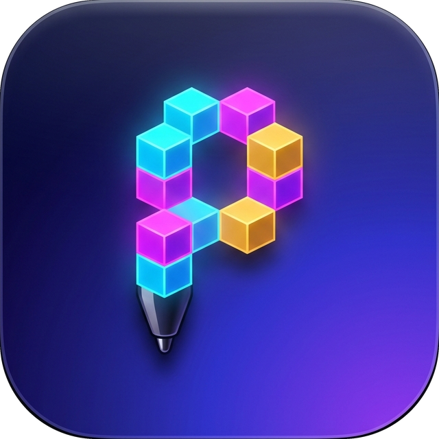

# PixelForge

<p align="center">
  
</p>

<p align="center">
  <strong>Современный, высокопроизводительный аппаратно-ускоренный редактор пиксель-арта и покадровой анимации для десктопных систем</strong>
</p>

<p align="center">
  
  
  
  
  
  
  
  
</p>

---

## 🚀 Ключевые возможности

### 🎬 Покадровая анимация и матричный таймлайн (Cel-Layer Matrix)
- **Архитектура Cel-Layer Matrix:** Слои как непрерывные горизонтальные дорожки и кадры как дискретные временные шаги. На пересечении слоя и кадра находится Cel со своим пиксельным буфером.
- **Индивидуальная длительность кадров:** Настройка длительности для каждого кадра в миллисекундах (от 10 мс до 5000 мс).
- **Теги анимации (Animation Tags):** Разметка диапазонов кадров (Idle, Walk, Attack, Jump) с индивидуальными цветами и режимами зацикливания (*Forward*, *Reverse*, *Ping-Pong*).
- **Сворачиваемый нижний док (Timeline Dock):** Транспортная панель с управлением воспроизведением, навигацией по кадрам, зумом таймлайна и регулировкой высоты через `GridSplitter` (<kbd>Tab</kbd>).

### 🧅 Аппаратная луковая шелуха (Zero-Alloc Onion Skinning)
- **Цветовой тинтинг со снижением прозрачности:** Предыдущие кадры подсвечиваются полупрозрачным красным оттенком, будущие — синим оттенком с прогрессивным затуханием прозрачности.
- **Гибкая глубина калек:** Настройка глубины от 1 до 5 кадров назад и вперед, регулировка максимальной прозрачности и режим «только активный слой».
- **Zero GC-Alloc SkiaSharp Pipeline:** Полное кэширование шейдеров, фильтров и палитр — 0 байт аллокаций в цикле рендеринга и стабильные 60+ FPS.

### 📺 Двойной режим воспроизведения (Dual Playback Engine)
- **Воспроизведение на основном холсте:** Модальный предпросмотр движения прямо на рабочем холсте. Клик мышью моментально останавливает воспроизведение на выбранном кадре для продолжения рисования.
- **Автономное окно мини-превью (Mini-Preview Window):** Отдельное плавающее окно, в реальном времени проигрывающее зацикленную анимацию в масштабе 1x–8x со скоростью 0.25x–4x параллельно с рисованием на холсте.

### 📦 Профессиональный игровой экспорт
- **Анимированный GIF:** Встроенный чистый C# GIF89a энкодер с адаптивным квантованием палитры, поддержкой прозрачности и циклов Netscape 2.0.
- **Спрайтшит (Texture Atlas) + JSON:** Экспорт сеткой (Grid), горизонтальной или вертикальной полосой с настраиваемыми отступами и генерацией **Aseprite-совместимого JSON-манифеста** (нативная поддержка в Unity, Godot, Phaser).
- **Покадровый PNG (Sequence):** Экспорт серии пронумерованных PNG-файлов (`frame_000.png`...).

### 🖌️ Инструменты рисования и Pixel-Perfect (<kbd>Shift+P</kbd>)
- **Pixel-Perfect алгоритм:** Устранение L-лесенок и угловых дубликатов на диагоналях в реальном времени для карандаша и ластика.
- **Кисть с 8×8 паттернами (<kbd>P</kbd>):** 11 ретро-пресетов дизеринга на 64-битных битовых масках (Checkerboard, Crosshatch, Bricks, Scales и др.).
- **Стабилизатор штриха (0..10):** Экспоненциальное сглаживание микро-дрожания руки.
- **Волшебная палочка (Magic Wand <kbd>W</kbd>):** Смежное (Contiguous) и глобальное выделение по цвету с настраиваемым порогом Tolerance.
- **Alpha Lock на слоях:** Блокировка изменения прозрачных пикселей для чистого шейдинга.
- **Смарт-инструменты:** Авто-обводка (Outline), авто-тень (Shadow), замена цвета (Color Replace), генератор рамп (Color Ramp).
- **Бесшовный режим тайлов (Seamless 3x3 <kbd>F10</kbd>):** Закольцованное рисование с живым предпросмотром соседних копий тайла.

### 💾 Надежность и формат проектов `.pxproj v2`
- **100% обратная совместимость:** Файлы проектов формата v1 автоматически и без потерь конвертируются в покадровый формат v2.
- **Разреженная история Undo/Redo:** Хранение истории на дельтах пикселей (`PixelDelta`), автоматический переход к кадру команды при отмене/повторе.
- **Транзакционное сохранение:** Запись во временный `.tmp` файл с атомарной заменой `File.Move(..., overwrite: true)`.

---

## ⌨️ Горячие клавиши (Shortcuts)

| Действие | Хоткей | Описание |
| :--- | :---: | :--- |
| **Карандаш (Pencil)** | <kbd>B</kbd> | Рисование с поддержкой Pixel-Perfect |
| **Ластик (Eraser)** | <kbd>E</kbd> | Стирание пикселей |
| **Пипетка (Eyedropper)** | <kbd>I</kbd> | Захват цвета с холста |
| **Заливка (Fill)** | <kbd>G</kbd> | Быстрая заливка области с допуском |
| **Паттерн-кисть (Pattern Brush)** | <kbd>P</kbd> | Рисование дизерингом и 8×8 текстурами |
| **Волшебная палочка (Magic Wand)** | <kbd>W</kbd> | Выделение пикселей по цвету |
| **Воспроизведение / Пауза** | <kbd>Space</kbd> / <kbd>Enter</kbd> | Запуск и остановка анимации |
| **Следующий / Предыдущий кадр** | <kbd>.</kbd> / <kbd>,</kbd> | Шаг вперед / назад по таймлайну |
| **Первый / Последний кадр** | <kbd>Home</kbd> / <kbd>End</kbd> | Переход к началу или концу анимации |
| **Новый кадр** | <kbd>F6</kbd> / <kbd>Alt+N</kbd> | Создание нового кадра на таймлайне |
| **Дублировать кадр** | <kbd>F5</kbd> | Клонирование текущего кадра со всеми слоями |
| **Удалить кадр** | <kbd>Delete</kbd> | Удаление активного кадра |
| **Луковая шелуха (Onion Skin)** | <kbd>O</kbd> | Включение/выключение калек соседних кадров |
| **Скрыть / Показать таймлайн** | <kbd>Tab</kbd> | Сворачивание нижней панели анимации |
| **Тайловый режим (Seamless 3x3)** | <kbd>F10</kbd> | Включение сетки 3×3 для бесшовных текстур |
| **Отмена / Повтор** | <kbd>Ctrl+Z</kbd> / <kbd>Ctrl+Y</kbd> | Разреженная история изменений |

---

## 🛠️ Сборка и запуск

### Требования:
- [.NET 8.0 SDK](https://dotnet.microsoft.com/download/dotnet/8.0)
- Windows 10/11 x64

```bash
# Клонирование репозитория
git clone https://github.com/widlily-corp/PixelForge.git
cd PixelForge

# Сборка проекта в Release
dotnet build PixelForge.sln -c Release

# Запуск тестов (712 тестов)
dotnet test PixelForge.sln -c Release

# Запуск редактора
dotnet run --project src/PixelForge.App/PixelForge.App.csproj -c Release
```

---

## 📄 Лицензия

PixelForge распространяется под лицензией **Apache 2.0**.
