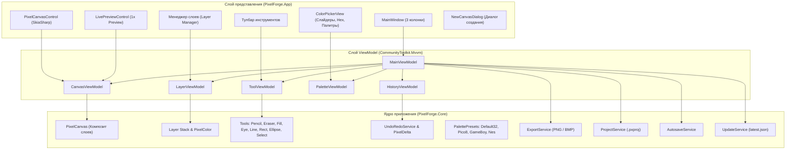

# PixelForge

<p align="center">
  
</p>

<p align="center">
  <strong>Современный, быстрый и отзывчивый редактор пиксель-арта для настольных систем</strong>
</p>

<p align="center">
  
  
  
  
  
  
</p>

---

## 🎨 Возможности

- **Многослойный холст:**
  - Неограниченное число слоев, регулировка прозрачности (0–100%), включение/выключение видимости, слияние слоев вниз (`Merge Down`), дублирование.
- **Аппаратно-ускоренный рендеринг SkiaSharp:**
  - Плавное панорамирование и масштабирование (1x..32x) с центрированием на курсоре мыши.
  - Режим `NearestNeighbor` без размытия пикселей.
  - Адаптивная пиксельная сетка при зуме ≥ 4x.
- **Полный набор инструментов пиксель-арта:**
  - **Карандаш (B):** Непрерывный штрих с интерполяцией Брезенхейма.
  - **Ластик (E):** Очистка пикселей до прозрачности.
  - **Заливка (G):** Быстрый алгоритм Flood Fill связных областей.
  - **Пипетка (I):** Мгновенное взятие цвета с активного слоя или композита.
  - **Линия (L):** Прямые линии с предпросмотром при перетаскивании.
  - **Прямоугольник (R/U):** Контурные и залитые прямоугольники.
  - **Эллипс (C):** Симметричные окружности и эллипсы (Midpoint-алгоритм).
  - **Выделение (S/M):** Прямоугольная область с поддержкой перемещения, вырезания, копирования и вставки.
- **Симметричное рисование в реальном времени:**
  - Зеркальное отражение по оси X (горизонталь) и по оси Y (вертикаль) для всех инструментов рисования.
- **Live Preview 1x:**
  - Нативная панель предпросмотра арта в истинном масштабе 1:1 на шахматном фоне прозрачности с возможностью быстрого переключения в 2x и 4x.
- **Палитра и ColorPicker:**
  - RGBA слайдеры с визуальной индикацией значений.
  - Ввод цвета в шестнадцатеричном формате (`#RRGGBB` / `#AARRGGBB`).
  - Быстрая смена основного и фонового цветов (`X`).
  - Встроенные ретро-палитры: **DawnBringer 32 (Default 32)**, **PICO-8 (16)**, **GameBoy (4)**, **NES (54)**.
  - Добавление пользовательских цветов в палитру на лету.
- **Разреженная история действий (Undo/Redo):**
  - Экономия памяти: сохраняются только измененные пиксели (`PixelDelta`), а не копии холста.
- **Файловый формат и экспорт:**
  - Собственный формат `.pxproj` (JSON с base64-кодированными буферами слоев и палитрой).
  - Фоновое автосохранение с защитой от сбоев.
  - Экспорт в **PNG** (с сохранением альфа-канала) и **BMP**.
- **Темы оформления:**
  - Темная тема (Dark Theme) по умолчанию и светлая тема (Light Theme) с переключением в меню.
- **OTA-обновления:**
  - Проверка обновлений через GitHub Releases (`latest.json`) при старте и по кнопке в меню «Справка».

---

## ⌨️ Таблица горячих клавиш

| Инструмент / Действие | Горячая клавиша | Описание |
| :--- | :---: | :--- |
| **Карандаш (Pencil)** | <kbd>B</kbd> | Рисование основным цветом |
| **Ластик (Eraser)** | <kbd>E</kbd> | Стирание пикселей в прозрачность |
| **Заливка (Paint Bucket)** | <kbd>G</kbd> | Заливка связной области цвета |
| **Пипетка (Eyedropper)** | <kbd>I</kbd> | Взятие цвета под курсором |
| **Линия (Line)** | <kbd>L</kbd> | Отрезок по алгоритму Брезенхейма |
| **Прямоугольник (Rectangle)** | <kbd>R</kbd> / <kbd>U</kbd> | Рисование прямоугольников |
| **Эллипс (Ellipse)** | <kbd>C</kbd> | Рисование эллипсов и кругов |
| **Выделение (Selection)** | <kbd>S</kbd> / <kbd>M</kbd> | Прямоугольное выделение пикселей |
| **Поменять цвета (Swap Colors)** | <kbd>X</kbd> | Поменять местами Primary и Secondary |
| **Отмена (Undo)** | <kbd>Ctrl</kbd> + <kbd>Z</kbd> | Отменить последнее действие |
| **Повтор (Redo)** | <kbd>Ctrl</kbd> + <kbd>Y</kbd> / <kbd>Ctrl</kbd>+<kbd>Shift</kbd>+<kbd>Z</kbd> | Повторить отмененное действие |
| **Новый проект** | <kbd>Ctrl</kbd> + <kbd>N</kbd> | Создать новый холст (с диалогом выбора размера) |
| **Открыть проект** | <kbd>Ctrl</kbd> + <kbd>O</kbd> | Загрузить файл `.pxproj` |
| **Сохранить проект** | <kbd>Ctrl</kbd> + <kbd>S</kbd> | Сохранить проект |
| **Сохранить как...** | <kbd>Ctrl</kbd> + <kbd>Shift</kbd> + <kbd>S</kbd> | Сохранить проект под новым именем |
| **Копировать** | <kbd>Ctrl</kbd> + <kbd>C</kbd> | Скопировать выделение или слой в буфер |
| **Вырезать** | <kbd>Ctrl</kbd> + <kbd>X</kbd> | Вырезать выделение в буфер |
| **Вставить** | <kbd>Ctrl</kbd> + <kbd>V</kbd> | Вставить пиксели из буфера как плавающее выделение |
| **Включить/выключить сетку** | <kbd>Ctrl</kbd> + <kbd>G</kbd> | Переключение отображения пиксельной сетки |
| **Приблизить масштаб** | <kbd>Ctrl</kbd> + <kbd>+</kbd> / Колесо мыши вверх | Увеличение зума холста |
| **Отдалить масштаб** | <kbd>Ctrl</kbd> + <kbd>-</kbd> / Колесо мыши вниз | Уменьшение зума холста |
| **Панорамирование (Pan)** | <kbd>Space</kbd> + Перетаскивание / Средняя кнопка мыши | Смещение области просмотра холста |

---

## 🏛️ Архитектурная схема



---

## 📌 Инвариант версионирования (Strict Versioning Invariant)

- **Базовая версия релиза:** строго **`0.0.1`**.
- **Правило инкремента:** каждый последующий релиз на GitHub инкрементируется **СТРОГО на +0.0.1** (`0.0.1` -> `0.0.2` -> `0.0.3`...).
- **Мажорные скачки:** изменение минорной или мажорной версии (например, `0.1.0` или `1.0.0`) разрешено **только по прямой текстовой команде пользователя**.
- Версия синхронизирована во всех компонентах:
  - `PixelForge.App.csproj` (`<Version>0.0.1</Version>`);
  - Заголовок окна приложения (`PixelForge v0.0.1`);
  - Диалог «О программе» (About Dialog);
  - Манифест обновлений `latest.json` и релизные теги Git (`v0.0.1`).

---

## 🛠️ Сборка и публикация

### Требования
- [.NET 8.0 SDK](https://dotnet.microsoft.com/download/dotnet/8.0)

### Сборка всего решения
```bash
dotnet build PixelForge.sln
```

### Запуск тестов
```bash
dotnet test tests/PixelForge.Core.Tests/PixelForge.Core.Tests.csproj
```

### Релизная публикация автономного EXE (win-x64, Self-Contained Single File)
```bash
dotnet publish src/PixelForge.App/PixelForge.App.csproj -c Release -r win-x64 --self-contained -p:PublishSingleFile=true
```
Собранный исполняемый файл будет расположен в:
`src/PixelForge.App/bin/Release/net8.0/win-x64/publish/PixelForge.App.exe`

---

## 📄 License & Notice

This project is licensed under the Apache-2.0 License - see the [LICENSE](LICENSE) file for details.

NOTICE: Copyright 2026 widlily-corp.
